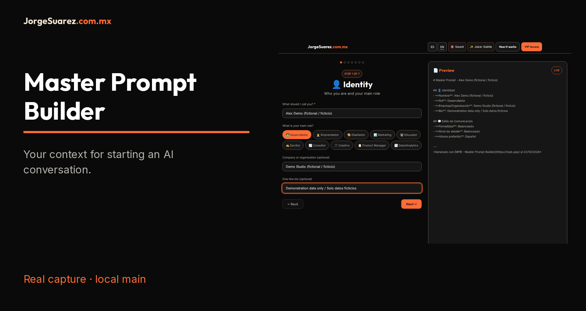
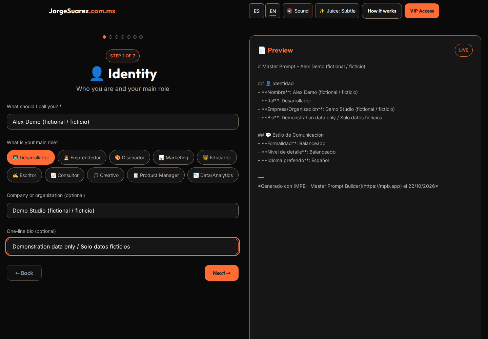
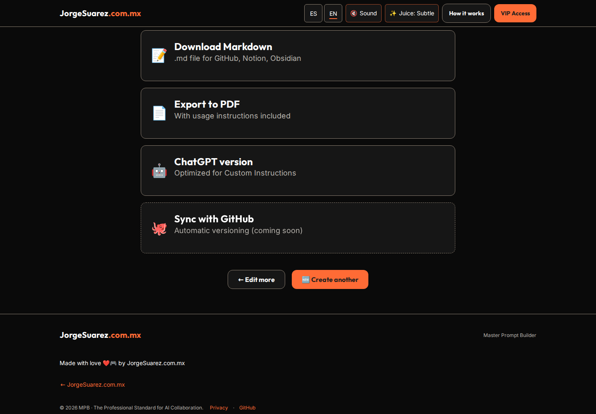

[Español](README.md) | [English](README.en.md)

# Master Prompt Builder

## What is it and why does it exist?
A guided editor for writing a document with your context, tools and response preferences. It helps you avoid rewriting that introduction; it does not automatically connect to or configure any AI and does not guarantee better answers.

## Who is it for?
People already using an AI assistant who want reusable instructions. A modern browser is enough; using the website requires no programming or registration. Hosting your own copy requires technical help.

## How do I start?
1. Open [Master Prompt Builder](https://mpb.jorgesuarez.com.mx). This guide verifies a local `main` copy, not the public deployment.
2. Press **Create my Digital DNA Free** and choose **Start from scratch**. Do not use VIP Access; this walkthrough does not need it.
3. Try **Alex Demo (fictional / ficticio)** and **Demo Studio (fictional / ficticio)**: fictional demonstration data, not a real person or company. Choose a role and a description without secrets.
4. Follow Identity, Context, Stack, Communication, Rules, Projects and Review using **Next**. Adjust what you need; not every field is required.
5. Review the result and press **Download Markdown**. We opened the downloaded file and checked that it retained the fictional name. You may then paste the reviewed text into your assistant under its own terms.

On a phone: [readable portrait screenshot](docs/media/mobile-identity-en.png). Open screenshots at full size to read every control.

## When should I use it or avoid it?
Use it to prepare reusable context. Do not store passwords, case files, customer data or instructions that must function as enforceable security controls.

## Where and what is available?
[Public website](https://mpb.jorgesuarez.com.mx) · [Source](https://github.com/jorgefsb/master-prompt-builder). Verified from local `main` on October 22, 2026. Other deployments and pending branch/PR features were not verified.

## Cost and licensing
The account-free walkthrough showed no charge. External AI assistants may charge. This snapshot has no LICENSE file: a public repository does not imply MIT licensing or general redistribution permission. Branding has separate restrictions.

## Privacy
Fields are stored in this browser/origin's `localStorage`; this is not an encrypted vault. Exported files remain where you download them. Clearing site data can erase drafts and history; export first. The app loads Supabase from a CDN and contains authentication and lead capture: we do not claim the whole site is offline or never contacts third parties. We submitted no forms, real personal data or VIP requests. Pasting content into another AI is subject to its privacy rules.

## Limits and help
- Markdown downloads verified in ES and EN. Interface language does not guarantee a fully translated export; the EN example retains Spanish labels/values.
- Copy, ChatGPT format and print/PDF window exist in code but were not tested in this walkthrough. PDF uses browser printing, not a standalone PDF generator.
- LinkedIn and GitHub sync are future features. Login, sync, history through the UI and imports were not verified.
- For problems, [open an issue](https://github.com/jorgefsb/master-prompt-builder/issues) without sensitive data. There is no guaranteed support response time.

## Video and next steps

[MP4 · EN](docs/media/walkthrough-en.mp4) · [VTT](docs/media/walkthrough-en.vtt) · [Texto / Transcript](docs/media/transcript-en.md)

[Technical guide](docs/TECHNICAL.en.md) · [Documentation canon](docs/REPOSITORY-DOCUMENTATION.en.md) · [Media notice](docs/ASSET-NOTICE.md)

Built by [Jorge Suárez](https://jorgesuarez.com.mx) · [Brandkit oficial / Official brandkit](https://brandkit.jorgesuarez.com.mx/)
