<div align="center">

<a href="https://mpb.jorgesuarez.com.mx"></a>

<br />

<a href="./README.md"></a>


<br />

**[▶ Probar MPB](https://mpb.jorgesuarez.com.mx)** · Más proyectos en [github.com/jorgefsb](https://github.com/jorgefsb)

</div>

---

<p align="center"></p>
<p align="center"><sub>Recorrido real del sitio en vivo, grabado el 10 nov 2026 en Chromium (1280×720). Sin retoque. <a href="docs/readme/tour.mp4">Ver el video MP4</a></sub></p>

## ¿Qué es?

Una web app que te guía paso a paso para crear, mantener y exportar tu Master Prompt: el documento que le dice a una IA quién eres, cómo trabajas y cómo te gusta que te respondan.

## ¿Para quién es?

Para cualquiera que usa ChatGPT, Claude u otra IA seguido en su trabajo y ya se cansó de explicarse desde cero.

## ¿Qué dolor resuelve?

Cada vez que abres un chat nuevo, la IA no sabe quién eres. O vuelves a explicar tu rol, tus proyectos y tus reglas, o recibes respuestas genéricas.

## La propuesta

Escribirlo una sola vez. Un wizard de 7 pasos arma el prompt con ejemplos que puedes tocar, y lo exportas para pegarlo donde quieras.

| Paso | Qué captura |
|---|---|
| 1. Identidad | Nombre, rol, empresa |
| 2. Contexto | Industria y responsabilidades |
| 3. Stack | Herramientas y tecnologías |
| 4. Comunicación | Cómo te gusta que te respondan |
| 5. Reglas | Lo que siempre o nunca quieres |
| 6. Proyectos | En qué estás trabajando |
| 7. Revisión | Editas y cierras |

## ¿Cómo se usa?

1. Abre [mpb.jorgesuarez.com.mx](https://mpb.jorgesuarez.com.mx).
2. Elige cómo empezar: de cero, pegando un prompt que ya tengas o con tus memorias de ChatGPT.
3. Completa los pasos y revisa la vista previa.
4. Copia el resultado, descárgalo en Markdown o expórtalo a PDF.
5. Pégalo en las instrucciones de tu IA.

## ¿Cuándo conviene y cuándo no?

Conviene si usas una IA varias veces por semana y quieres respuestas a tu medida desde el primer mensaje.

Todavía no hay cuentas: tu avance se guarda solo en tu navegador, así que no se sincroniza entre dispositivos. Importar desde LinkedIn y sincronizar con GitHub están marcados como próximamente.

## ¿Dónde lo pruebo?

En vivo: **[mpb.jorgesuarez.com.mx](https://mpb.jorgesuarez.com.mx)**

<p align="center">
  
  
</p>
<p align="center"><sub>Capturas reales del sitio en vivo, 10 nov 2026: escritorio (1280×720) y móvil (390×780).</sub></p>

## Hasta dónde llegamos

Funciona hoy: wizard de 7 pasos, ejemplos clicables, vista previa en tiempo real, exportación a PDF, Markdown y texto, guardado local con versiones.

Pendiente en el roadmap: cuentas, panel de administración, sincronización con GitHub, API pública y app móvil.

## Para quien construye

JavaScript sin framework (ES Modules), CSS con variables y `localStorage`. No hay paso de build.

```bash
git clone https://github.com/jorgefsb/master-prompt-builder.git
cd master-prompt-builder
python3 -m http.server 3000
npm test   # integridad de marca y aislamiento de idioma del wizard
```

| Ruta | Qué hay |
|---|---|
| `index.html` | Punto de entrada |
| `js/app.js`, `js/wizard.js` | Aplicación y pasos del wizard |
| `js/generator.js`, `js/export.js` | Generación y exportación del prompt |
| `js/storage.js` | Guardado local y versiones |
| `css/` | Sistema visual y animaciones |

## Licencia

Este repo no tiene archivo de licencia, así que el código conserva todos los derechos. Úsalo libremente en [mpb.jorgesuarez.com.mx](https://mpb.jorgesuarez.com.mx).

---

<div align="center">

<sub>Hecho con amor ❤️🎮 por <a href="https://jorgesuarez.com.mx">JorgeSuarez.com.mx</a> · <a href="https://github.com/jorgefsb">Más proyectos</a> · <a href="./README.md">Read in English</a><br />Documentación actualizada el 10 nov 2026.</sub>

</div>
