<div align="center">

<a href="https://mpb.jorgesuarez.com.mx"></a>

<br />


<a href="./README.es.md"></a>

<br />

**[▶ Try MPB](https://mpb.jorgesuarez.com.mx)** · More projects at [github.com/jorgefsb](https://github.com/jorgefsb)

</div>

---

<p align="center"></p>
<p align="center"><sub>Real walkthrough of the live site, recorded 10 Nov 2026 in Chromium (1280×720). No retouching. It plays once; reload the page to watch it again. <a href="docs/readme/tour.mp4">Watch the MP4 video</a></sub></p>

## What is it?

A web app that walks you through creating, maintaining and exporting your Master Prompt: the document that tells an AI who you are, how you work and how you like to be answered.

## Who is it for?

For anyone who uses ChatGPT, Claude or another AI often at work and is tired of explaining themselves from scratch.

## What pain does it solve?

Every time you open a new chat, the AI does not know who you are. You either explain your role, your projects and your rules again, or you get generic answers.

## The proposal

Write it once. A 7-step wizard builds the prompt with examples you can click, and you export it to paste wherever you want.

| Step | What it captures |
|---|---|
| 1. Identity | Name, role, company |
| 2. Context | Industry and responsibilities |
| 3. Stack | Tools and technologies |
| 4. Communication | How you like to be answered |
| 5. Rules | What you always or never want |
| 6. Projects | What you are working on |
| 7. Review | Edit and finish |

## How do I use it?

1. Open [mpb.jorgesuarez.com.mx](https://mpb.jorgesuarez.com.mx).
2. Choose how to start: from scratch, by pasting a prompt you already have, or with your ChatGPT memories.
3. Complete the steps and check the live preview.
4. Copy the result, download it as Markdown or export it to PDF.
5. Paste it into your AI's instructions.

## When it fits and when it doesn't

It fits if you use an AI several times a week and want tailored answers from the first message.

There are no accounts yet: your progress is saved only in your browser, so it does not sync across devices. Importing from LinkedIn and syncing with GitHub are marked as coming soon. The interface is in Spanish.

## Where can I try it?

Live: **[mpb.jorgesuarez.com.mx](https://mpb.jorgesuarez.com.mx)**

<p align="center">
  
  
</p>
<p align="center"><sub>Real screenshots of the live site, 10 Nov 2026: desktop (1280×720) and mobile (390×780).</sub></p>

## How far we got

Working today: the 7-step wizard, clickable examples, live preview, export to PDF, Markdown and text, and local saving with versions.

Still on the roadmap: accounts, an admin panel, GitHub sync, a public API and a mobile app.

## For builders

Framework-free JavaScript (ES Modules), CSS custom properties and `localStorage`. There is no build step.

```bash
git clone https://github.com/jorgefsb/master-prompt-builder.git
cd master-prompt-builder
python3 -m http.server 3000
npm test   # brand integrity and wizard language isolation
```

| Path | What lives there |
|---|---|
| `index.html` | Entry point |
| `js/app.js`, `js/wizard.js` | App and wizard steps |
| `js/generator.js`, `js/export.js` | Prompt generation and export |
| `js/storage.js` | Local saving and versions |
| `css/` | Visual system and animations |

## License

This repo has no license file, so all rights are reserved on the code. Use it freely at [mpb.jorgesuarez.com.mx](https://mpb.jorgesuarez.com.mx).

---

<div align="center">

<sub>Made with love ❤️🎮 by <a href="https://jorgesuarez.com.mx">JorgeSuarez.com.mx</a> · <a href="https://github.com/jorgefsb">More projects</a> · <a href="./README.es.md">Leer en español</a><br />Documentation updated on 10 Nov 2026.</sub>

</div>

<!-- HERDR-CONTEXT:START -->
## Contexto del proyecto y clasificación en Herdr

Constructor de contexto e instrucciones reutilizables para trabajar con asistentes de IA.

**Espacio:** `02 LAB | REV | Master Prompt Builder`. **Unidad:** Unidad pendiente de confirmar.

### Clasificación

La etiqueta LAB identifica una clasificación de catálogo pendiente de revalidación; no implica inactividad. REV significa unidad propietaria pendiente de confirmar. Los números ordenan navegación; no son un ranking de ingresos.

Se conserva la documentación original y el crédito a sus autores. Esta sección no certifica disponibilidad actual ni modifica el runtime. Actualizada el 28-oct-2026.

<!-- HERDR-CONTEXT:END -->
