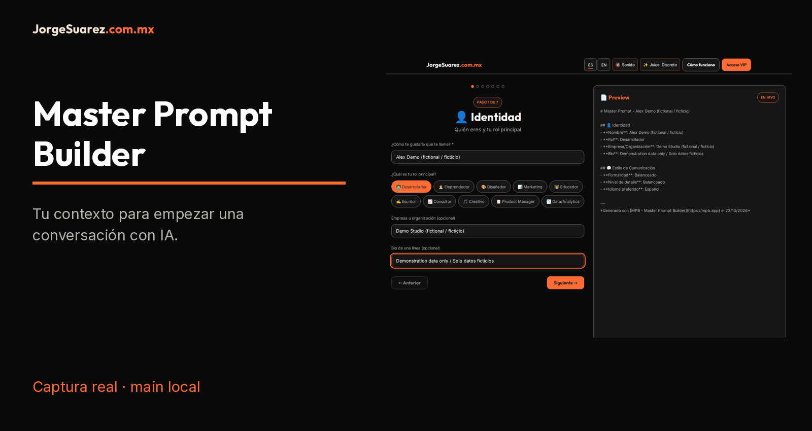
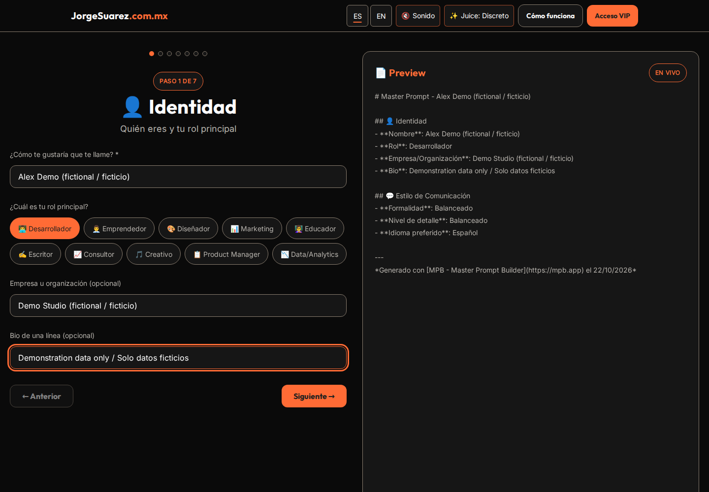
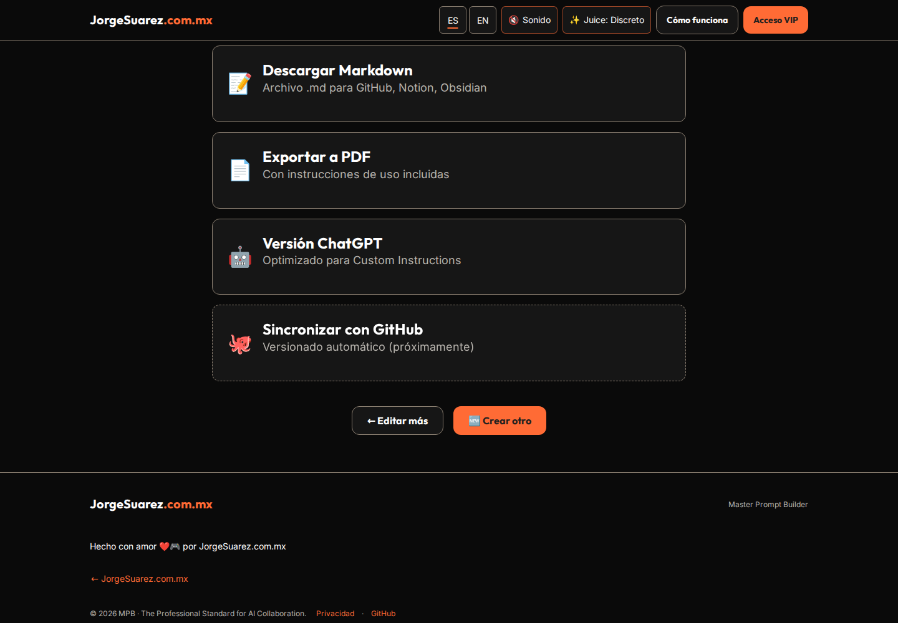

[Español](README.md) | [English](README.en.md)

# Master Prompt Builder

## ¿Qué es y por qué existe?
Un editor guiado para escribir un documento con tu contexto, herramientas y preferencias de respuesta. Evita volver a redactar esa presentación; no conecta ni configura automáticamente ninguna IA y no garantiza mejores respuestas.

## ¿Para quién?
Personas que ya usan un asistente de IA y quieren preparar instrucciones reutilizables. Basta un navegador moderno; para probar la web no necesitas programar ni registrarte. Para alojar tu propia copia sí necesitas ayuda técnica.

## ¿Cómo empiezo?
1. Abre [Master Prompt Builder](https://mpb.jorgesuarez.com.mx). La verificación de esta guía corresponde a la copia local de `main`, no certifica el despliegue público.
2. Pulsa **Crear mi DNA Digital Gratis** y elige **Empezar de cero**. No uses Acceso VIP: no es necesario para este recorrido.
3. Prueba con **Alex Demo (fictional / ficticio)** y **Demo Studio (fictional / ficticio)**: son datos ficticios, no una persona ni empresa reales. Elige un rol y escribe una descripción sin secretos.
4. Recorre Identidad, Contexto, Stack, Comunicación, Reglas, Proyectos y Revisión con **Siguiente**. Ajusta lo que quieras; no hace falta llenar cada campo.
5. Revisa el resultado y pulsa **Descargar Markdown**. Abrimos el archivo descargado y comprobamos que conserva el nombre ficticio. Después puedes pegar el texto revisado en tu asistente, bajo sus propias condiciones.

En teléfono: [captura vertical legible](docs/media/mobile-identity-es.png). Abre las capturas a tamaño completo para leer cada control.

## ¿Cuándo usarlo y cuándo no?
Úsalo para preparar contexto reutilizable. No lo uses como almacén de contraseñas, expedientes, datos de clientes ni instrucciones que deban cumplirse como controles de seguridad.

## ¿Dónde y en qué estado?
[Web pública](https://mpb.jorgesuarez.com.mx) · [Código](https://github.com/jorgefsb/master-prompt-builder). Verificado desde `main` local el 22 de octubre de 2026. No se verificaron otros despliegues ni funciones de ramas/PR pendientes.

## Costos y licencia
El recorrido sin cuenta no mostró cobro. Los asistentes externos pueden cobrar. No hay archivo LICENSE en este snapshot: un repositorio público no equivale a licencia MIT ni permiso general de redistribución. La marca tiene restricciones separadas.

## Privacidad
Los campos se guardan en `localStorage` de este navegador/origen; no es una bóveda cifrada. Los archivos exportados quedan donde los descargues. Borrar los datos del sitio puede eliminar borrador e historial; guarda tu exportación antes. La app carga Supabase desde un CDN y contiene autenticación y captura de leads: no afirmamos que toda la web sea offline ni que nunca contacte a terceros. No enviamos formularios, datos personales reales ni solicitudes de acceso VIP. Al pegar texto en otra IA, aplican sus reglas de privacidad.

## Límites y ayuda
- Markdown: descarga comprobada en ES y EN. El idioma de la interfaz no garantiza que todo el contenido exportado se traduzca; el ejemplo EN conserva etiquetas/valores en español.
- Copiar, versión ChatGPT y ventana de impresión/PDF existen en código, pero no se probaron en este recorrido. PDF usa impresión del navegador, no un generador PDF independiente.
- LinkedIn y sincronización GitHub aparecen como futuras. No se verificaron login, sincronización, historial desde la interfaz ni importaciones.
- Para problemas, [abre un issue](https://github.com/jorgefsb/master-prompt-builder/issues) sin datos sensibles. No hay soporte con plazo garantizado.

## Video y siguientes pasos

[MP4 · ES](docs/media/walkthrough-es.mp4) · [VTT](docs/media/walkthrough-es.vtt) · [Texto / Transcript](docs/media/transcript-es.md)

[Guía técnica](docs/TECHNICAL.md) · [Canon de documentación](docs/REPOSITORY-DOCUMENTATION.md) · [Aviso de medios](docs/ASSET-NOTICE.md)

Construido por [Jorge Suárez](https://jorgesuarez.com.mx) · [Brandkit oficial / Official brandkit](https://brandkit.jorgesuarez.com.mx/)
